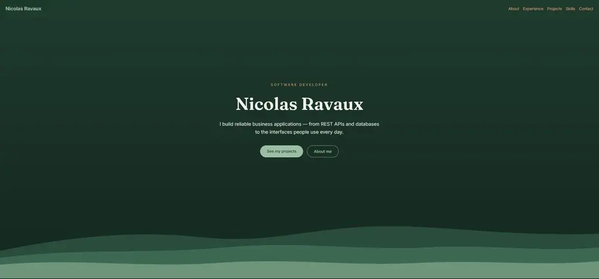

# 🌲 Nicolas Ravaux — Portfolio v2

My personal portfolio, designed and built from scratch around a forest theme.

**🔗 [my website](https://nicolasravaux.be)**



## About this project

I'm a software developer with 3 years of experience on business applications: a financial ERP used by more than 10,000 people, REST APIs and the Microsoft Power Platform. This site presents my experience, projects and skills. I also used it to practise modern front-end development with React and TypeScript.

It replaces my [first portfolio](https://github.com/NicolasR64/Portefolio) (2022). That one was an exercise in rebuilding an existing site from its visual appearance. This one was designed entirely by me.

## Features

- **Parallax hero** driven by CSS scroll-driven animations (`animation-timeline: scroll()`)
- **Scroll-triggered reveal animations** using a custom `useReveal` hook built on `IntersectionObserver`
- **Navigation bar that highlights the current section**, plus a shadow once you leave the hero, through a reusable `useInView` hook
- **Mobile side menu** with an animated burger icon. It closes with Escape and locks scrolling while open
- **Filterable skills section** whose height animates smoothly between categories, using `ResizeObserver`
- **Alternating light and dark sections** handled by a single `.section-dark` class that redefines the theme's CSS variables
- **Shared `TimelineItem` component** for experiences and projects, with an alternating layout
- **Downloadable resume** and a back-to-top button that only appears after the hero

## Accessibility and performance

- Respects `prefers-reduced-motion`: animations are disabled for users who ask for less motion
- Text colours meet WCAG AA contrast requirements
- Keyboard-friendly navigation: real buttons, `aria-expanded` and `aria-current`, and hidden elements removed from the tab order
- Lazy-loaded images. Animated previews are served as WebP: 2 MB instead of 37 MB of GIFs
- Self-hosted variable fonts (Inter and Fraunces)

## Tech stack

| | |
|---|---|
| Framework | React 19 + TypeScript |
| Build tool | Vite |
| Styling | Tailwind CSS v4 (`@theme` tokens) |
| Linting | Oxlint |

## Project structure

```
src/
├── components/   # Page sections (Hero, About, Experience, Projects, Skills, Contact…) and shared UI
├── hooks/        # useReveal, useInView
├── assets/img/   # Logos and project previews
├── cv.ts         # All content: experiences, projects, skills, contact links
├── type.ts       # TypeScript types for the content
└── index.css     # Theme tokens, dark sections, animations
```

All the content lives in `cv.ts`. Adding a project or a skill only means adding an entry there.

## Getting started

```bash
npm install
npm run dev      # start the dev server
npm run build    # type-check and build for production
npm run lint     # run Oxlint
```

## Contact

- 📫 nicolasravaux64@gmail.com
- 💼 [LinkedIn](https://www.linkedin.com/in/nicolas-ravaux-232114290/)
- 🐙 [GitHub](https://github.com/NicolasR64)
